# TP1-DAR2026 — Les sockets en mode connecté TCP
## Activité 1-1 : Première connexion client-serveur 
## 1. Vérification de l’environnement
Cette capture d’écran montre la vérification des versions de Git et de Java avec les commandes `git --version` et 
`java --version`.

## 2. Création du projet Java
Cette capture d’écran présente la structure du projet `TP1-DAR2026`, contenant les packages `serverPackage` et `clientPackage`, avec les classes `Server.java` et `Client.java`.

## 3. Démarrage du serveur
Cette capture d’écran montre le serveur TCP démarré sur le port 5000. Le serveur attend la connexion d’un client grâce à la méthode `accept()`.

## 4. Connexion du client au serveur
Cette capture d’écran montre l’exécution du client TCP et l’établissement de la connexion avec le serveur sur le port 5000.

## 5. Vérification de la connexion côté serveur
Cette capture d’écran montre que le serveur a accepté la connexion du client grâce à la méthode `accept()`.

## 6. Test de connexion avec une adresse IP

Cette capture d’écran montre la modification de l’adresse utilisée par le client. Le nom `localhost` est remplacé par l’adresse IPv4 de la machine afin de tester la connexion TCP.

## 7. Résultat du test avec une adresse IP

Le test de connexion a réussi. Le client a pu établir une connexion TCP avec le serveur en utilisant l’adresse IPv4 de la machine sur le port 5000.

## Activité 1-2 : Service de calculatrice
## 1. Exécution du serveur

Nous avons lancé l'application Serveur en premier. Le serveur attend les connexions du client et reçoit les entiers envoyés pour effectuer la multiplication par 5. 

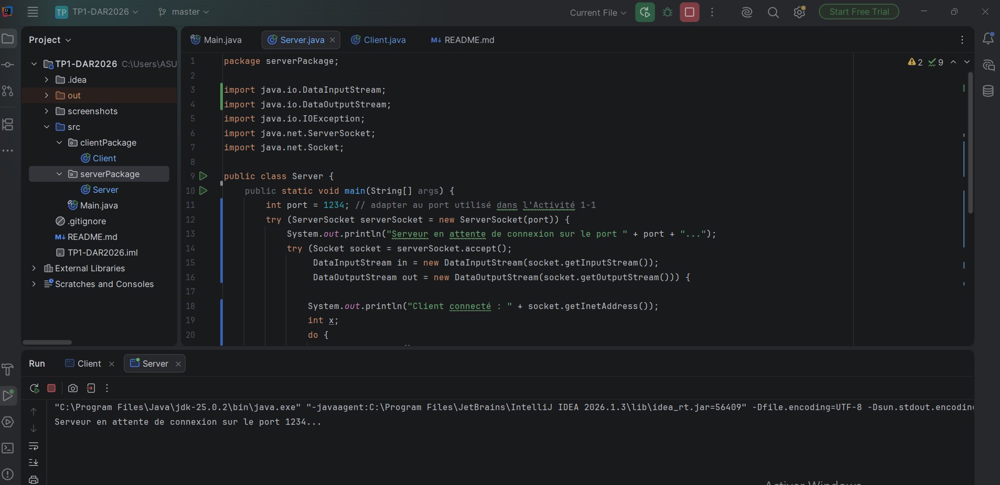
## 2.Exécution du client

Après le lancement du serveur, nous avons exécuté l'application Client afin d'établir une connexion TCP avec le serveur.

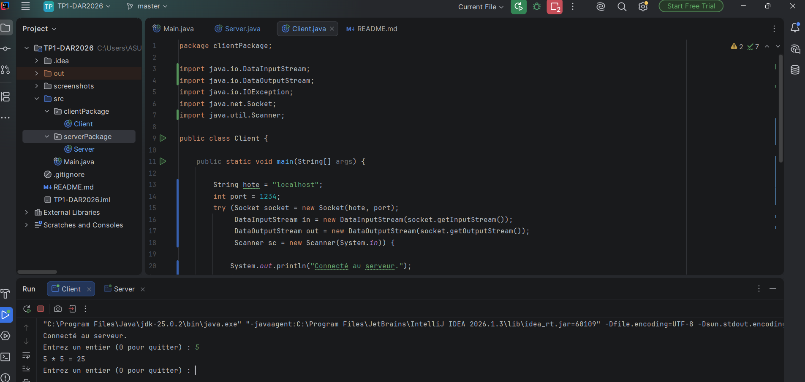
## 3.Test avec un nombre positif

Nous avons saisi un nombre positif. Le serveur multiplie cette valeur par 5 et renvoie le résultat au client.

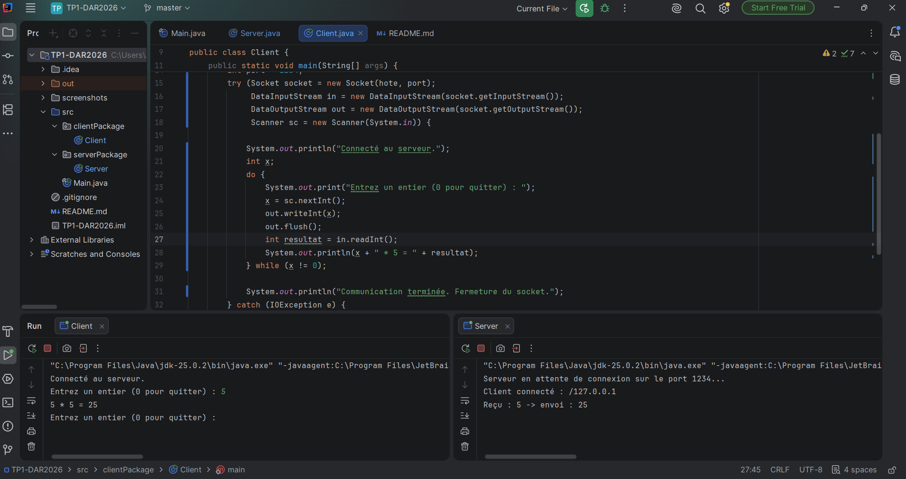

## 4.Test avec un nombre négatif

Nous avons saisi un nombre négatif pour vérifier que le programme effectue correctement la multiplication par 5 et renvoie un résultat négatif.

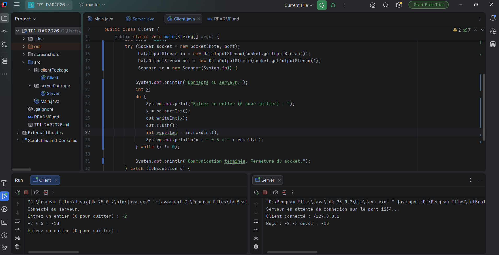

## 5.Test avec zéro

Nous avons saisi la valeur zéro. Le résultat du calcul est zéro et cette saisie permet de terminer la communication entre le client et le serveur, conformément aux consignes du TP.

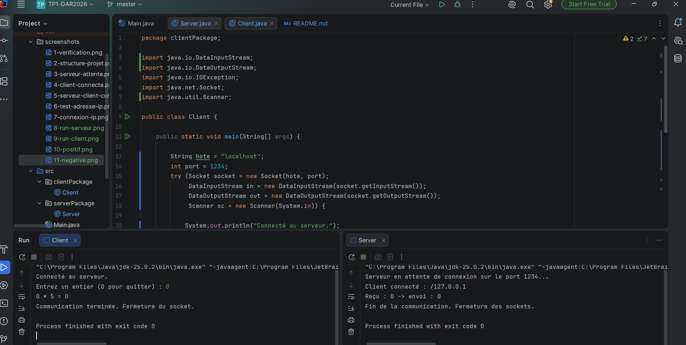
# Activité 1-3 : Amélioration du service de calculatrice
## Étape 1 : Connexion Client/Serveur
L'application utilise InetAddress et InetSocketAddress pour gérer l'adresse IP et le port de communication. Le serveur écoute sur l'adresse IP 192.168.31.17 et le port 5000.
Le client utilise cette adresse pour se connecter au serveur
## 1.Exécution du serveur
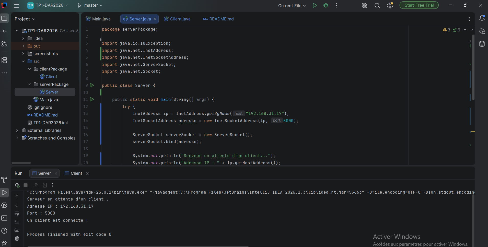
## 2.Connexion du client
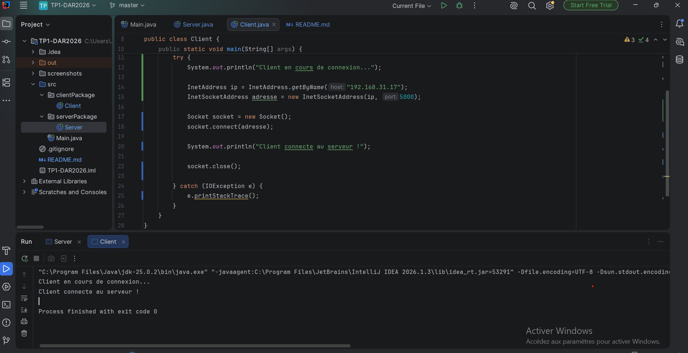
## Étape 2 : Calculatrice améliorée

Le client propose quatre opérations : addition, soustraction, multiplication et division. Il transmet le choix de l'opération et la valeur x au serveur.
Le serveur effectue le calcul et renvoie le résultat au client.

# 1.Test de l'addition
Ce test permet de vérifier le fonctionnement de l’addition. Pour x = 10, le serveur calcule 10 + 5 et renvoie le résultat 15.

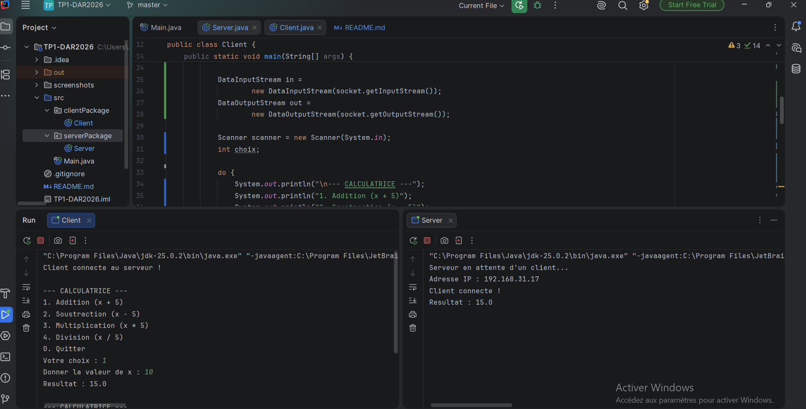
# 2.Test de la soustraction
Ce test permet de vérifier le fonctionnement de la soustraction. Pour x = 10, le serveur calcule 10 - 5 et renvoie le résultat 5.

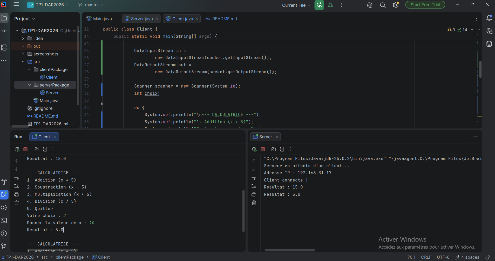
# 3.Test de la multiplication
Ce test permet de vérifier le fonctionnement de la multiplication. Pour x = 10, le serveur calcule 10 × 5 et renvoie le résultat 50.

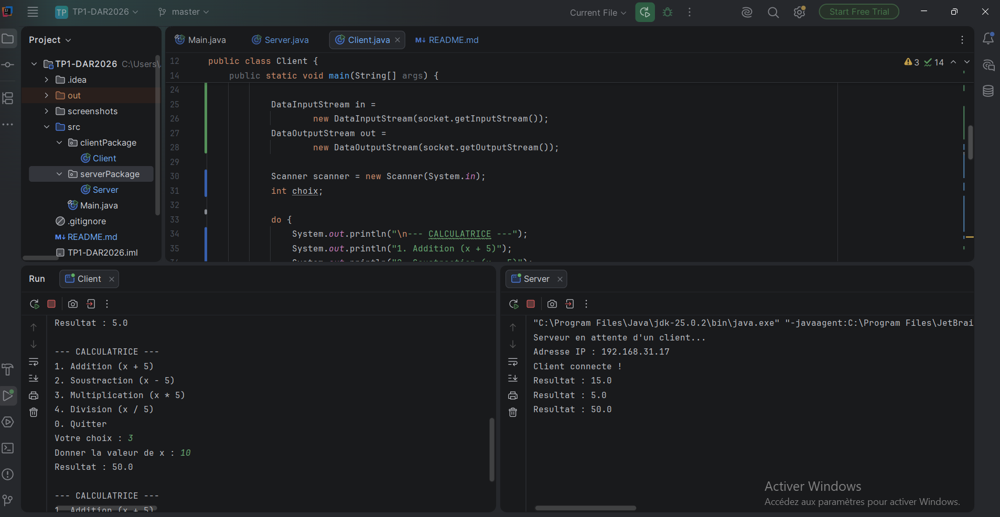
# 4.Test de la division
Ce test permet de vérifier le fonctionnement de la division. Pour x = 10, le serveur calcule 10 / 5 et renvoie le résultat 2.

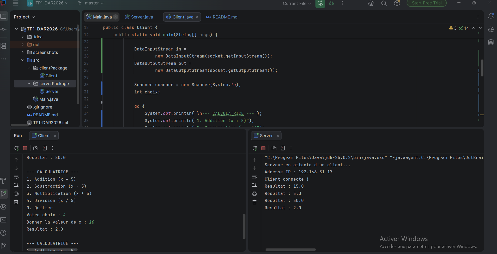
# 5.Arret de l'application
Le client peut quitter l’application en sélectionnant l’option 0 dans le menu. Le serveur reçoit cette commande, termine la communication avec le client et ferme la connexion.
Cette fonctionnalité permet d’arrêter proprement l’application après les tests.

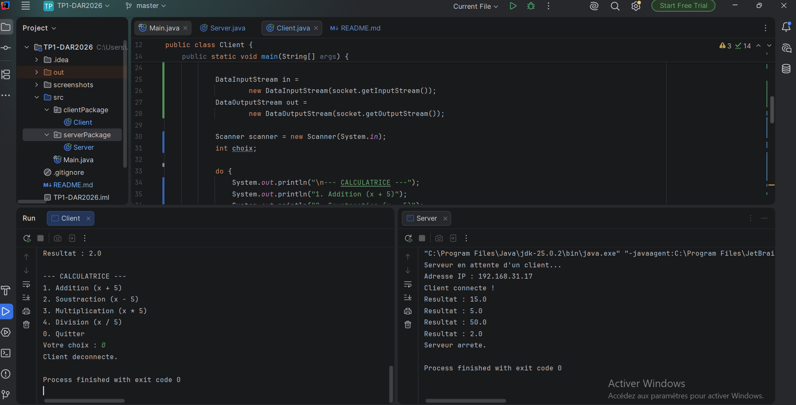

