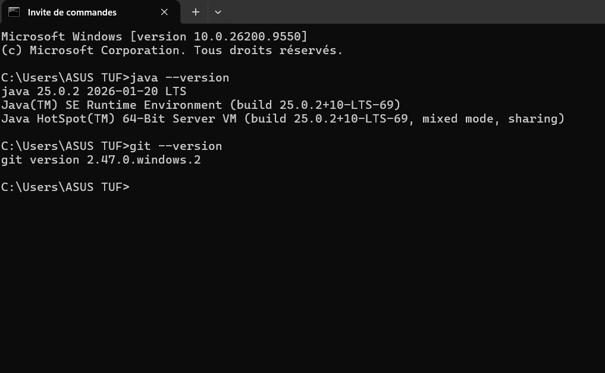
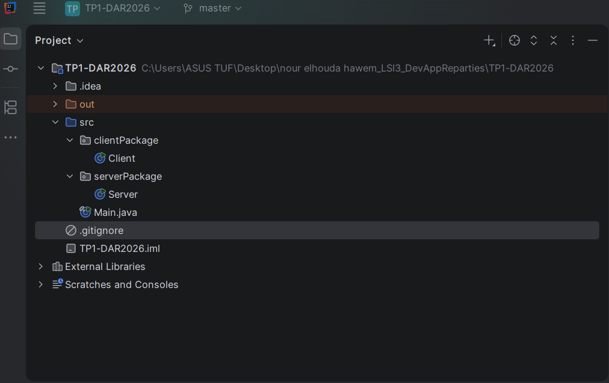
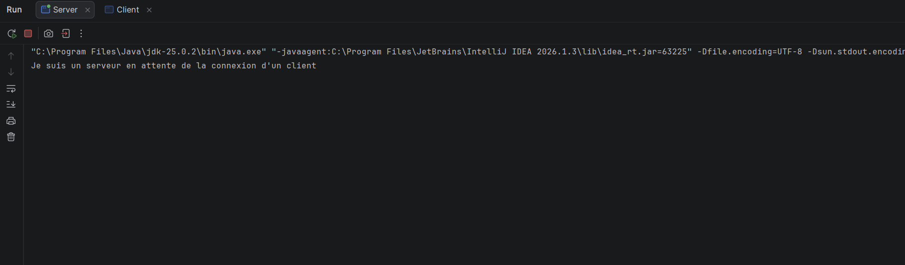
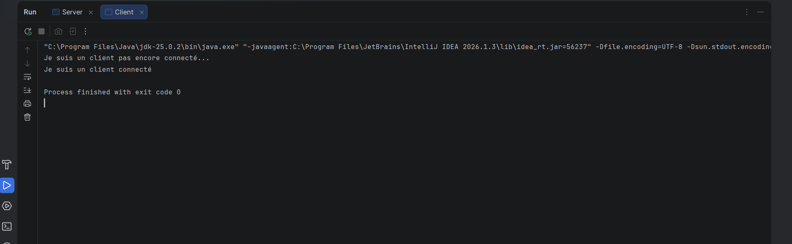
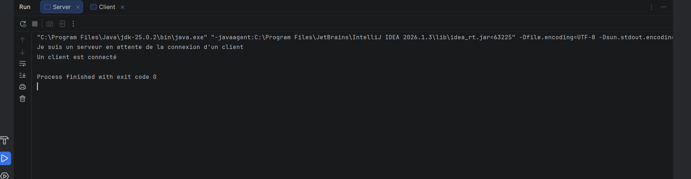
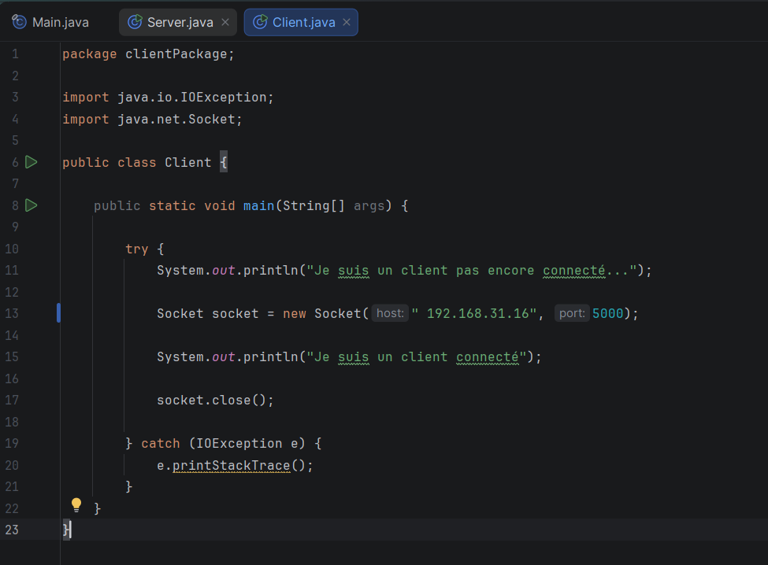
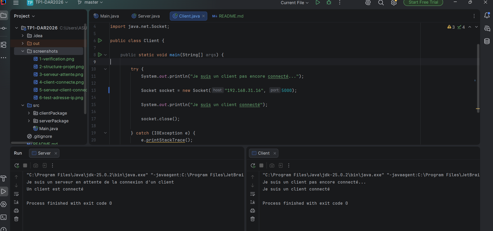

# TP1-DAR2026 — Les sockets en mode connecté TCP

## 1. Vérification de l’environnement
Cette capture d’écran montre la vérification des versions de Git et de Java avec les commandes `git --version` et 
`java --version`.

## 2. Création du projet Java
Cette capture d’écran présente la structure du projet `TP1-DAR2026`, contenant les packages `serverPackage` et `clientPackage`, avec les classes `Server.java` et `Client.java`.

## 3. Démarrage du serveur
Cette capture d’écran montre le serveur TCP démarré sur le port 5000. Le serveur attend la connexion d’un client grâce à la méthode `accept()`.

## 4. Connexion du client au serveur
Cette capture d’écran montre l’exécution du client TCP et l’établissement de la connexion avec le serveur sur le port 5000.

## 5. Vérification de la connexion côté serveur
Cette capture d’écran montre que le serveur a accepté la connexion du client grâce à la méthode `accept()`.

## 6. Test de connexion avec une adresse IP

Cette capture d’écran montre la modification de l’adresse utilisée par le client. Le nom `localhost` est remplacé par l’adresse IPv4 de la machine afin de tester la connexion TCP.

## 7. Résultat du test avec une adresse IP

Le test de connexion a réussi. Le client a pu établir une connexion TCP avec le serveur en utilisant l’adresse IPv4 de la machine sur le port 5000.

